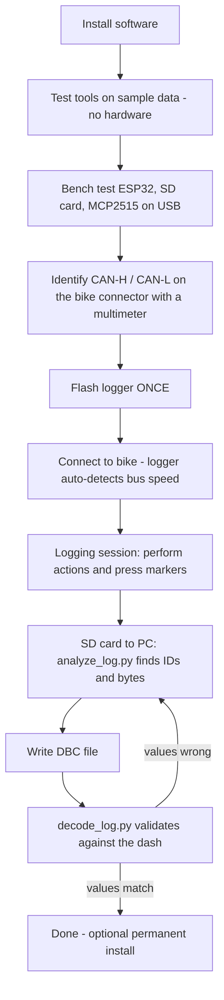

# Dominar CAN Logger

Log the CAN bus of a Bajaj Dominar with an **ESP32 + MCP2515 + SD card**, then turn the log into your own **DBC file** 

The logger only *listens* (MCP2515 listen-only mode). It never transmits or acknowledges on the bike's bus.

## How the project flows



## Repository layout

```
dominar-can-logger/
├── README.md                  <- you are here
├── firmware/
│   ├── dominar_can_logger/
│   │   └── dominar_can_logger.ino    <- the ONLY sketch you flash to the bike
│   └── bench_tests/                  <- one-off hardware checks (steps 3-5)
│       ├── esp32_hello/
│       ├── sd_card_test/
│       └── mcp2515_spi_test/
├── tools/                     <- run on your PC
│   ├── analyze_log.py
│   ├── decode_log.py
│   ├── make_sample_log.py     <- fake bike log for testing without a bike
│   └── requirements.txt
├── dbc/
│   └── dominar_template.dbc   <- copy to dominar.dbc and fill in
├── docs/
│   ├── wiring.md              <- full wiring, voltage levels, power chain
│   ├── oscilloscope_testing.md
│   └── dbc_format.md          <- how to write signals into the DBC
└── sample_data/               <- fake log + matching DBC for testing the tools
```

## Parts

| Part | Notes |
|---|---|
| ESP32 dev board (WROOM-32) | Any standard devkit |
| MCP2515 CAN module with transceiver | Check the crystal (8 or 16 MHz, printed on the metal can) and its supply voltage (see step 0) |
| 4-channel bidirectional level shifter | Needed for the common 5V MCP2515 module (see `docs/wiring.md`) |
| SPI microSD module + card | FAT32, 32 GB or smaller |
| USB power bank or USB cable to laptop | Power source while reverse-engineering |
| Multimeter | For finding CAN-H/CAN-L on the connector |
| Jumper wires | |
| *Later, permanent install only:* buck converter (6-40V in, 5V out, 1A+), 1A fuse and holder, 1N5400 diode, enclosure | |
| *Optional:* 2-channel oscilloscope (PicoScope) | `docs/oscilloscope_testing.md` |

## Step 0 - Read before touching anything

- **Bike parked, never while riding.** Do speed-related tests only with the rear wheel safely lifted on a proper stand, or in a safe closed area with a helper. Never operate the logger while riding.
- **Power the ESP32 from USB while reverse-engineering.** Do not use the bike's 12V yet. Cranking dips and charging spikes on a bike's 12V rail are harsh.
- **Voltage levels:** the common blue MCP2515 module runs at 5V and outputs 5V logic on MISO, which the ESP32 cannot tolerate. Read the voltage section of [`docs/wiring.md`](docs/wiring.md) before wiring.
- **Remove the MCP2515 module's 120 ohm termination jumper** before connecting to the bike (the bike is already terminated).
- Only use this on your own bike. Listen-only logging is passive, but do not add transmit code to a live vehicle bus.

## Step 1 - Install software

1. **Arduino IDE 2.x** from arduino.cc.
2. Add ESP32 support: *File > Preferences > Additional boards manager URLs*, add `https://espressif.github.io/arduino-esp32/package_esp32_index.json`, then *Tools > Board > Boards Manager*, search **esp32** (by Espressif) and install.
3. *Tools > Manage Libraries*, install **"mcp2515" by autowp** (repo name `arduino-mcp2515`). The SD and SPI libraries are built in.
4. Select the board **ESP32 Dev Module** and the right COM port.
5. Python 3.9+ on your PC, then:
   ```
   pip install -r tools/requirements.txt
   ```

## Step 2 - Test the PC tools with fake data (no hardware)

This proves the analysis half of the project works before you spend time on hardware.

```
cd tools
python make_sample_log.py ../sample_data/sample_canlog.csv
python analyze_log.py ../sample_data/sample_canlog.csv --events
python decode_log.py ../sample_data/sample_canlog.csv ../sample_data/sample_test.dbc -o decoded_sample.csv
```

Expected: `--events` reports the RPM byte at marker `r`, the brake bit at `b`, and the turn-signal bits at `t`; the decode step reports `Decoded frames: 1600`, `decode errors: 0`, and RPM around 6000 during the blip. (The IDs in the sample are made up, not real Dominar IDs.)

## Step 3 - Bench test 1: ESP32 alone

Wiring: USB only. Open `firmware/bench_tests/esp32_hello`, upload.

**Pass:** the LED blinks and the Serial Monitor (115200 baud) prints a line every second.

## Step 4 - Bench test 2: SD card

Wire the SD module only (see `docs/wiring.md`). Format the card **FAT32**. Upload `firmware/bench_tests/sd_card_test`.

**Pass:** Serial Monitor shows `PASS: wrote and read back test file`.

## Step 5 - Bench test 3: MCP2515

Wire the MCP2515 (with the level shifter or divider). Set `CRYSTAL` in the sketch to match your board. Upload `firmware/bench_tests/mcp2515_spi_test`. No bike or bus is needed.

**Pass:** `PASS: loopback frame sent and received correctly`.

This checks SPI wiring and power. It does *not* check the crystal setting or the transceiver, which are confirmed in step 8.

## Step 6 - Identify the pins on the bike connector

The 6-pin diagnostic connector, as identified on your bike:

| Pin | Function |
|---|---|
| 1 | Ground |
| 2 | CAN-H |
| 3 | OEM-specific diagnostic line |
| 4 | K-Line |
| 5 | CAN-L |
| 6 | Battery +12V |

Verify with a multimeter (ignition off, logger disconnected):

1. Pin 1 has continuity to the battery negative or chassis.
2. Pin 6 shows about 12V to ground (check with ignition off and on to learn whether it is always-on or switched).
3. Resistance between pins 2 and 5 is typically **about 60 ohm** (two 120 ohm terminators), or about 120 ohm if only one terminator is reachable through this connector. An open circuit or a dead short means it is not the CAN pair; recheck the pinout before connecting anything.

## Step 7 - Flash the logger (once)

Open `firmware/dominar_can_logger/dominar_can_logger.ino`. Confirm `CRYSTAL` matches your board (`MCP_8MHZ` or `MCP_16MHZ`). Upload.

You never need to reflash it. On every power-up it scans 125/250/500/1000 kbps in listen-only mode, picks the speed with the most clean frames, retries until the bus is alive, and starts a new numbered file on the SD card.

## Step 8 - Connect to the bike and verify

1. Ignition **OFF**. Connect: connector pin 2 to `CANH`, pin 5 to `CANL`, pin 1 to `GND`. Leave pins 3, 4 and 6 unconnected. Logger powered from USB.
2. Open the Serial Monitor (115200), then turn the ignition **ON**.
3. Expected output:
   ```
   SD OK.
   Scanning CAN bitrate (listen-only)...
     125 kbps -> clean frames: 0, error hits: ...
     500 kbps -> clean frames: 1234, error hits: ...
   Detected bus speed: 500 kbps
   Logging to /canlog_001.csv
   Frames/sec: 480   Total: 480
   ```
4. The onboard LED stays on while frames are arriving.
5. If it keeps printing `No bus activity found`, see Troubleshooting.
6. *(Optional)* confirm the electrical signal with a scope: `docs/oscilloscope_testing.md`.

## Step 9 - Logging session

The logger gives you two ways to mark "I just did X": type a character in the Serial Monitor + Enter, or press the ESP32 **BOOT** button (logs `*`). Do not hold BOOT while powering on or resetting.

Work through this sequence. Press the marker **first**, then do the action, then wait about 3 seconds before the next one. Repeat every action at least 3 times; repeated patterns make the byte changes obvious.

| Order | Action | Marker |
|---|---|---|
| 1 | Ignition ON, engine OFF, touch nothing for 20 s (baseline) | none |
| 2 | Turn signal on, wait 5 s, turn off | `t`, then `T` |
| 3 | High beam on, wait 5 s, off | `h`, then `H` |
| 4 | Front brake lever squeeze, hold 3 s, release | `b` |
| 5 | Rear brake, hold 3 s, release | `c` |
| 6 | Start engine | `e` |
| 7 | Idle 20 s | none |
| 8 | Hold steady RPM at 2000, 3000, 4000 (read from the dash) for 3 s each | `r` at the start of each hold |
| 9 | Shift through gears with the rear wheel safely lifted | `g` at each change |
| 10 | Speed steps (only where safe) | `s` at each step, and note the dash speed on paper |
| 11 | Engine off | `x` |

Write down the real values you saw on the dash for steps 8 and 10. You need them to compute scale factors in step 11.

## Step 10 - Analyze

Power off, remove the SD card, copy `canlog_00N.csv` to your PC.

```
cd tools
python analyze_log.py canlog_001.csv                  # message rates + which bytes change
python analyze_log.py canlog_001.csv --events         # what changed at each marker
python analyze_log.py canlog_001.csv --id 1A0         # raw bytes of one ID around each marker
```

How to read it:

- **Message rate**: status data (RPM, speed) is usually sent at a steady 10-100 Hz.
- **`--events`**: shows `ID / byte: before -> after` for step changes at each marker. A byte that changes at *every* marker is usually a counter, not your signal.
- A byte with change-rate near 1.00 and a small repeating value set is almost certainly a rolling counter or checksum.
- For continuous signals (RPM, speed), use `--id` and compare against your written notes.

## Step 11 - Write the DBC

```
cp dbc/dominar_template.dbc dbc/dominar.dbc
```

Add a `BO_` block per message and an `SG_` line per signal. Full syntax, byte order, the scale/offset formula, and pitfalls (no `/* */` comments, decimal IDs) are in [`docs/dbc_format.md`](docs/dbc_format.md).

## Step 12 - Validate

```
python tools/decode_log.py canlog_001.csv dbc/dominar.dbc -o decoded_001.csv
```

Open `decoded_001.csv` and check the decoded values against your dash notes at the marker times. If they match at several points, the signal is right. If not, go back to step 10, and try the other byte order (`@0` vs `@1`) or another byte.

## Step 13 - Optional permanent install

Only after everything works on USB. Follow the power chain in `docs/wiring.md`: connector pin 6, then fuse, diode, buck converter (set to 5V and verified with a multimeter first), then ESP32. Check whether pin 6 is switched or always-on to avoid draining the battery.

## Troubleshooting

| Symptom | Likely cause |
|---|---|
| `SD init FAILED` | Wrong CS pin, card not FAT32, module needs 5V vs 3.3V, loose wiring |
| `bench test: FAIL setBitrate` | MCP2515 not answering: SPI wires, CS pin, power, level shifter |
| Scan finds 0 frames at every speed | Ignition off, CAN-H/CAN-L swapped or on the wrong pins, termination jumper still fitted, no common ground |
| Frames at two speeds | Pick the higher count; a real bus gives clean frames at only one speed |
| Log values look random | Wrong crystal setting: `CRYSTAL` does not match the board |
| ESP32 will not boot with everything wired | GPIO5/GPIO15 strapping pins: disconnect the CS wires, boot, reconnect |
| `cantools` refuses the DBC | Overlapping signals, `/* */` comments, or an ID given in hex instead of decimal |
| Decoded values off by a constant factor | Wrong scale in the DBC: recompute from two known points |

## Verification status

What has been tested, and what has not:

| Part | Status |
|---|---|
| `analyze_log.py`, `decode_log.py`, `make_sample_log.py` | **Tested** end to end on synthetic data: known values decode correctly (RPM scaling, speed, brake bit, turn-signal bits, extended IDs), and the event analysis isolates the real signals from counters and noise |
| DBC syntax rules in `docs/dbc_format.md` | **Tested** with cantools (little/big endian, bit fields, extended IDs, overlap rejection) |
| All four Arduino sketches | **Syntax-checked** against the real `arduino-mcp2515` library source with Arduino stubs. API names verified against the library headers |
| Firmware on real hardware, and on a real Dominar bus | **Not tested.** Nobody has run this on an ESP32 or a bike yet. Expect to adjust things (crystal setting, pins, bitrate list) |
| Dominar CAN IDs / signals | **Unknown.** No public DBC exists; discovering them is the point of the project |
